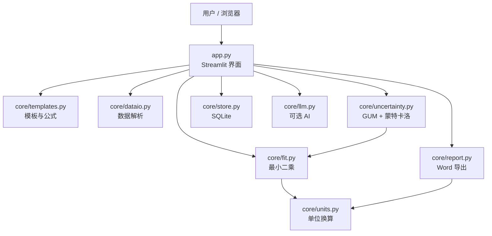
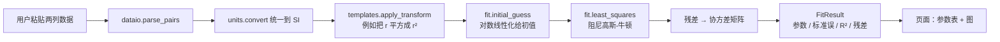
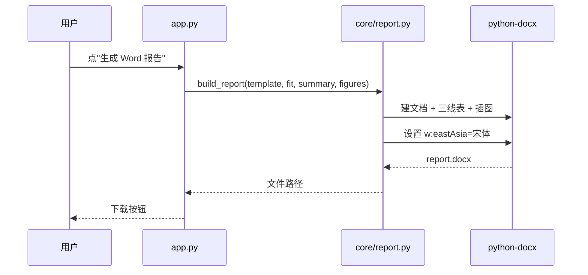

# 系统架构与核心调用链

> 用途：作业要求"代码结构图 + 2–3 个核心功能的函数调用流程图（可编辑矢量图）"。
> 下面的 Mermaid 可以直接粘进 draw.io（Arrange → Insert → Advanced → Mermaid），
> 再导出成矢量图；也可以照着重新画。

---

## 一、分层结构



原则：**`core/` 不 import streamlit**，可以单独测试、单独复用；
以后换 FastAPI + React 只改 `app.py`。

---

## 二、核心功能 1：拟合



对应函数：`fit()`、`initial_guess()`、`least_squares()`、`_jacobian()`。

---

## 三、核心功能 2：不确定度

```mermaid
flowchart TD
    A[FitResult] --> B{三条路线}
    B --> C[gum<br/>梯度 gᵀΣg]
    B --> D[mc_fast<br/>从参数分布抽样 1 万次]
    B --> E[mc_strict<br/>给原始数据加仪器噪声后重拟合]
    C --> F[u_stat 统计不确定度]
    D --> G[u_mc 校验值]
    E --> H[u_B 仪器不确定度]
    F --> I[budget<br/>u_c = √(u_stat²+u_B²)]
    H --> I
    I --> J[U = 2·u_c<br/>结果表达式]
```

- `gum()`：解析、快，但依赖"近似线性"。
- `mc_fast()`：验证线性近似是否成立，两者应接近。
- `mc_strict()`：把最难手算的 B 类传播交给重拟合。

---

## 四、核心功能 3：报告导出



---

## 五、数据结构

### 5.1 实验模板（JSON，`templates/experiments/*.json`）

| 字段 | 类型 | 说明 |
|---|---|---|
| `id` | string | 唯一标识 |
| `model` | enum | `linear` / `power` / `exponential` |
| `variables.x/y` | object | 变量名、单位、别名 |
| `target.expr` | string | 目标量公式，如 `4*pi**2/a**2` |
| `constants` | object | 公式常数，如 `lam` |
| `y_transform` | enum | `none` / `square` |
| `instruments` | array | 仪器名称、分辨率、对应变量 |
| `demo` | object | 演示数据，至少 3 组 |

### 5.2 原始数据（CSV）

两列：自变量、因变量；逗号/空格/制表符分隔；首行可以是表头。

### 5.3 SQLite（`data/lab.db`）

```sql
runs(
  id INTEGER PK,
  created_at TEXT,
  template_id TEXT,
  model TEXT,
  n_points INTEGER,
  params_json TEXT,
  cov_json TEXT,
  summary_json TEXT
)

reports(
  id INTEGER PK,
  run_id INTEGER FK -> runs.id,
  created_at TEXT,
  file_path TEXT
)
```

### 5.4 生成文件

- `reports/report_<模板>.docx`：报告
- `reports/fit_*.png`、`resid_*.png`、`uncertainty_hist.png`：插图

---

## 六、模块与函数清单（画代码目录结构图用）

| 文件 | 关键函数 | 职责 |
|---|---|---|
| `core/units.py` | `parse_quantity` `convert` `format_measurement` | 单位解析、换算、结果格式化 |
| `core/templates.py` | `load_templates` `eval_target` `apply_transform` | 模板加载、公式计算 |
| `core/fit.py` | `fit` `least_squares` `curve` | 拟合与协方差 |
| `core/uncertainty.py` | `gum` `mc_fast` `mc_strict` `budget` | 不确定度评定 |
| `core/report.py` | `build_report` | Word 报告 |
| `core/store.py` | `save_run` `save_report` `list_runs` | SQLite 持久化 |
| `core/dataio.py` | `parse_pairs` `decode_bytes` | 数据读入 |
| `core/llm.py` | `chat` `unknown_numbers` | 可选 AI + 数字回查 |

---

## 七、答辩时怎么讲这张图（30 秒版）

> 界面层只做展示，算法全在 core 里，所以能单元测试；
> 拟合产出参数和协方差，不确定度有三条路线互相验证，
> 最后报告把数字、表、图固定下来，AI 只写文字且要过数字回查。
